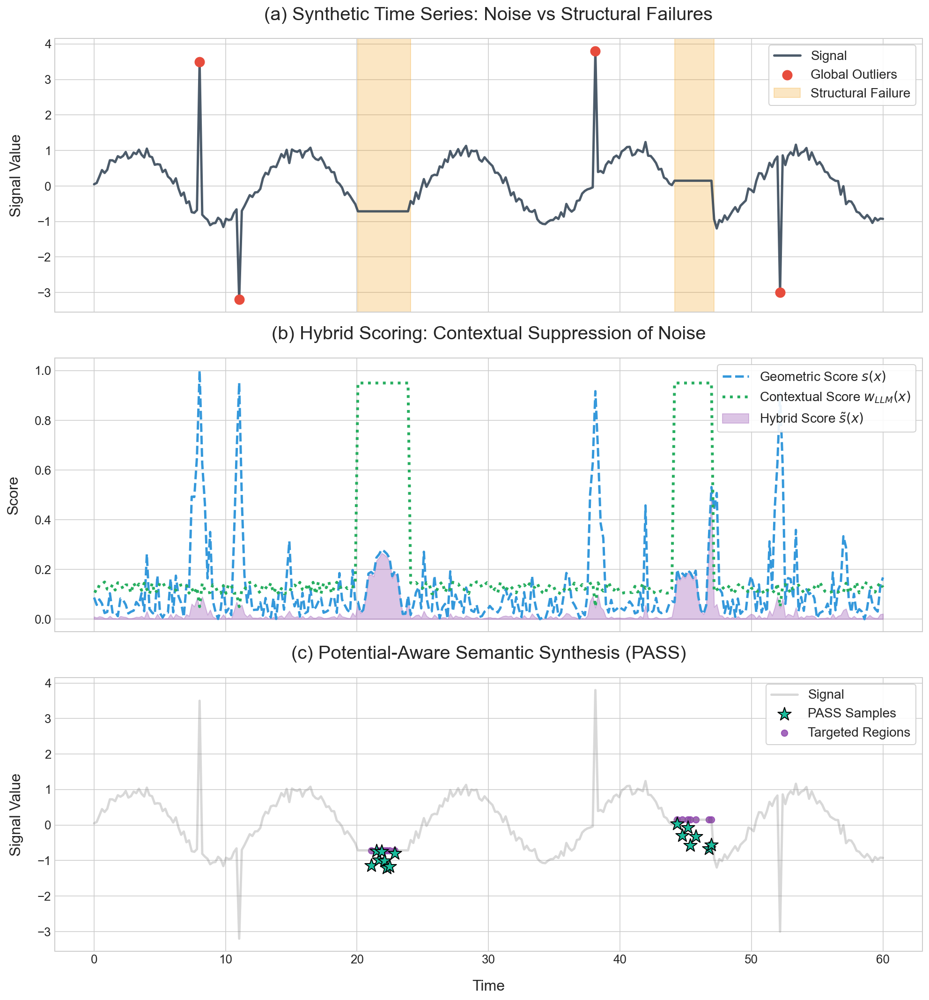
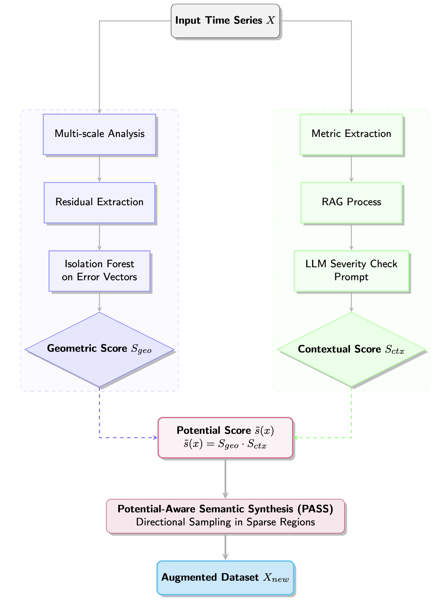

<div align="center">

# PASS

### Potential-Aware Semantic Synthesis for Time-Series

**Ben Hen** · **Neta Rabin**
School of Industrial & Intelligent Systems Engineering, Tel-Aviv University


</div>

---

Most time-series augmentation decides **how** to perturb a sample. Almost none
decides **where** to put it. And a purely geometric criterion cannot tell a
meaningful regime change from sensor noise, so it amplifies whichever deviation
happens to be largest.

PASS gives every training trajectory a scalar **potential**, the product of two
scores that fail in opposite directions:

> **`s̃(x) = S_geo(x) · S_ctx(x)`**

`S_geo` comes from the reconstruction error of a multi-scale kernel regression.
It knows where the data manifold is poorly approximated, and nothing about what
a deviation means. `S_ctx` comes from a retrieval-grounded language model that
reads the local geometry as text and judges whether the deviation is a
structurally meaningful event or benign noise. It knows the domain, and nothing
about the geometry of the signal.

New samples are then synthesised by **extrapolating along the ascent direction**
of that potential, past the boundary of the observed data rather than inside it,
with the regression target propagated along the same step.

<div align="center">

</div>

The figure is the argument in one picture. The synthetic signal **(a)** holds
two anomaly types: high-magnitude transient spikes, which are noise, and
flatline segments, which are sensor freezes and a real failure mode. In **(b)**
the geometric score fires on the spikes and misses the flatlines, while the
contextual score does the reverse. Their product suppresses the spikes and
promotes the flatlines, and **(c)** shows synthesis landing only where it
matters.

---

## How it works

<div align="center">

</div>

Two parallel streams meet at the potential score.

**Geometric.** A pyramid of Gaussian kernels of decreasing bandwidth smooths the
target iteratively, and the residual at each scale is z-scored and made
absolute. Stacking them gives each trajectory a multi-scale error signature, a
row saying how hard that trajectory is to reconstruct at every scale. An
Isolation Forest over those rows, negated and min-max mapped onto `[0, 1]`, is
`S_geo`.

**Semantic.** The local neighbourhood of each trajectory is summarised as a
handful of numbers: density, temporal discontinuity, volatility, the anisotropy
of a Ledoit-Wolf shrinkage covariance, and the Mahalanobis distance to the local
centroid. Those, with the error signature and domain constraints distilled from
the literature, are rendered into a structured prompt. The model returns one
number, a severity in `[0, 1]`, and that is `S_ctx`.

**The gate.** One model call per trajectory is the dominant cost of the
pipeline, so the model is queried only where it can change the outcome, on the
top `q`-quantile of `S_geo`. On a 400-trajectory series that is 40 calls rather
than 400.

**Synthesis.** Anchors are the trajectories above the potential threshold. For
each, a neighbour is drawn from its `k` nearest, the two potentials are compared
to fix the direction, and the new sample is placed a factor `γ ≥ 1` beyond the
pair. Comparing potentials is what removes the directional ambiguity that
symmetric interpolation schemes carry.

---

## Repository layout

```
.
├── pass_kbs.py             ← the method: Algorithms 1 and 2, and the two scores
├── rag.py                  ← Algorithm 3: retrieval, LLM ranking, distillation
├── laplacian_pyramids.py     the multi-scale kernel regression
│
├── forecaster.py             the fixed downstream forecaster
├── baselines.py              data-level baselines: none, SMOTE, STAug
├── timerag.py                the TimeRAG baseline
├── data.py                   loaders, scaling, chronological splits
├── metrics.py                RMSE, MAE, MASE, and the MMD of the shift appendix
├── llm.py                    local / hosted / constant backends, prompt cache
├── profiling.py              per-stage timing, call counts, tokens, memory
│
├── run_chickenpox.py         the Hungarian Chickenpox experiment
├── run_sensitivity.py        the distributional-shift check
└── docs/                     figures
```

Reading order: **`pass_kbs.py` alone is the method**, and every function names
the part of the paper it implements. Everything else is the harness around it.

| Paper | Function |
|---|---|
| `S_geo`, the normalised multi-scale geometric score | `geometric_score` |
| `L_t`, shrinkage covariance, anisotropy, Mahalanobis | `local_descriptors` |
| `G_t` and the percentile rank `R(x_t)` | `global_context`, `percentile_rank` |
| `P(x_t)`, the structured prompt of Algorithm 1 | `build_prompt` |
| `S_ctx`, the gated contextual score | `contextual_score` |
| `s̃(x) = S_geo · S_ctx` | `potential` |
| `X_high`, the anchors above `τ` | `high_potential_set` |
| `x_new`, `f_new`, the directional extrapolation | `synthesise` |
| Algorithm 2, end to end | `pass_augment` |
| Algorithm 3, the RAG pipeline | `rag.domain_insights` |

---

## Quickstart

```bash
pip install -r requirements.txt
ollama serve && ollama pull llama3          # the default backend
export PASS_DATA_ROOT=/path/to/datasets     # where the benchmark CSVs live

python run_chickenpox.py --rag
```

All 20 counties against three augmentation baselines under one fixed forecaster.
A per-county table and a timing profile land in `results/`.

### On your own data

```python
from pass_kbs import sliding_windows, median_sigma, geometric_score, pass_augment

X, f = sliding_windows(series, lookback=8, horizon=1)
sigma = median_sigma(X, scale=10)
geo   = geometric_score(X, f, sigma)

out = pass_augment(X, f, geo["S_geo"], geo["E"], score,
                   q=0.10, gamma=3, k=3, J=1, m=5)

X_train = np.vstack([X, out["X_aug"]])
f_train = np.concatenate([f, out["f_aug"]])
```

`score` is any callable `str -> str`, so the method depends on no provider or
SDK. `S_geo` and `E` are passed in rather than recomputed, so a whole
`(q, γ, k, J)` grid reuses one decomposition.

---

## The language model

Three interchangeable backends, chosen with `--backend`.

| | |
|---|---|
| **`ollama`** *(default)* | a local model. No API key, no quota, reproducible anywhere |
| `gemini` | the hosted configuration of the paper. Reads `GEMINI_API_KEY` from the environment |
| `constant` | pins the severity to 1, so the potential reduces to `S_geo`. The geometry-only ablation, and it needs no inference at all |

Responses are cached on disk by prompt hash. Since `γ`, `k` and `J` never reach
the prompt, the whole synthesis grid is free once the scoring pass is done, and
an interrupted run resumes where it stopped.

---

## Data

The benchmark CSVs are not redistributed here. Put them under a `datasets`
directory beside the code, or point `PASS_DATA_ROOT` elsewhere.

* **Hungarian Chickenpox** — `HungaryChickenpox/hungary_chickenpox.csv`, weekly
  case counts for 20 counties. The county graph is not used: each county is
  forecast as a separate univariate series from its own history, and the errors
  are averaged over the 20.
* **ILI** — `ILI/national_illness.csv`, weekly influenza-like illness ratios.

> **On units.** Every series is standard scaled before the windows are built, so
> the metrics are in standard deviations by default. `evaluate` takes a `scale`
> argument and then also reports `RMSE_orig` and `MAE_orig` in the units of the
> raw series, which for Chickenpox is cases per week. Both appear in the output
> table. On this benchmark the two differ by a factor of 23 to 77 depending on
> the county, so it matters which one a number is.

---

## Hyperparameters

| | Grid | |
|---|---|---|
| `q` | 0.05, 0.10 | quantile for the gate and the anchor threshold |
| `γ` | 1, 3, 5, 10, 50 | extrapolation step |
| `k` | 1, 2, 3 | neighbourhood for the synthesis |
| `J` | 1 … 5 | synthetic samples per anchor |
| `m` | 3, 5, 10 | local window for the structural descriptors |
| `C` | 0.5, 10, 50, 100 | bandwidth factor, `--sigma-scale` |

`--full-grid` uses all of it; the default thins it. The stopping scale `ℓ*` is
chosen by minimal reconstruction error and is not tuned.

Other flags worth knowing: `--counties 0 6 11`, `--methods none pass`,
`--forecaster consistent`, and `--q / --gamma / --k / --J / --m` to override a
single axis.

---

## Two properties worth knowing

**The gate is one-sided.** `S_ctx` is zero outside the geometric candidate set,
so a trajectory that is semantically critical but geometrically unremarkable is
invisible to the framework by construction. The ordering of `s̃` is meaningful
only within the candidate set.

**`J` past `k` adds weight, not support.** The neighbour is drawn from `k`
candidates and the step is otherwise deterministic, so an anchor admits at most
`k` distinct samples. Beyond that, a larger `J` raises their multiplicity in the
training set rather than extending the region they cover.

---

## Reproducibility

The only stochastic element is the neighbour draw, fixed by `--seed` (default
42). The downstream forecaster involves no gradient-based training and so adds
no optimisation noise of its own. `profiling.py` records per-stage wall-clock
time, call counts, token usage and peak memory for every run.

## Citation

```bibtex
@article{hen2026pass,
  title   = {Potential-Aware Semantic Synthesis (PASS) for Time-Series Forecasting},
  author  = {Hen, Ben and Rabin, Neta},
  journal = {Knowledge-Based Systems},
  year    = {2026}
}
```
